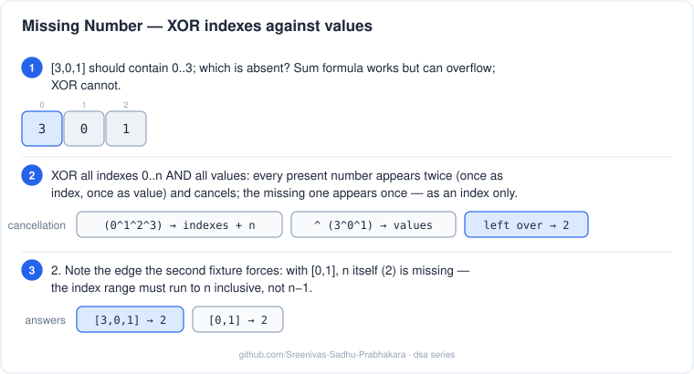

# Missing Number

> NeetCode 150 · Bit Manipulation · Blind 75 — XOR indexes against values: every present number pairs with its index-world twin, the absentee doesn't. Go, stdlib only, tested.

## Problem

An array holds n distinct numbers from {0..n}; one is missing. Find it in O(n)/O(1). (Not the same task as dsa-011's repeat-and-missing over 1..n with a duplicate — the specs differ at both ends.)

## Approach

Two complete copies of 0..n would XOR to zero. The array supplies values 0..n minus one absentee; the loop indexes supply 0..n−1; seeding the accumulator with n completes the index side. XOR everything: every present value cancels against its equal from the index side, leaving exactly the missing number. The Gauss-sum alternative (`n(n+1)/2 − sum`) is equally O(n)/O(1) and arguably more obvious — XOR's edge is immunity to overflow, which matters when n approaches the integer limit.

**Complexity:** O(n) time, O(1) space.

## Visual walkthrough

Read the picture top to bottom — each numbered frame is one moment of the algorithm
running on this repo's test example.

## Run

    go test ./...   # verify
    go run .        # demo

---

Part of a 275-repo DSA series in Go — Striver's SDE Sheet (dsa-001–191) plus the NeetCode 150 / Blind 75 additions (dsa-192–275), stdlib only, every solution tested. Browse: [`dsa-*` repos](https://github.com/Sreenivas-Sadhu-Prabhakara?tab=repositories&q=dsa-&type=source).
